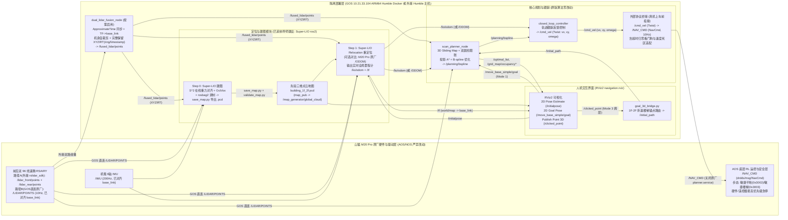

# 山猫 M20 Pro 四足机器人室内及跨楼层（1F–2F）自主导航真机部署方案 (`DEPLOYMENT_PLAN.md`)

> **文档用途**：供指导教师审核批准后，方可进入真机联调与实测阶段。  
> **目标实车**：云深处 **山猫 M20 Pro**（三主机架构：AOS `10.21.33.103` / NOS `10.21.33.106` / GOS `10.21.33.104`，前后双 96 线速腾 RSAIRY 激光雷达 + 200 Hz IMU）。  
> **目标场景**：室内平地走廊及 1 楼至 2 楼折返楼梯（初期验收范围：1F–2F）。  
> **核心技术栈**：`SCAN-Planner`（ROS 2 Humble 移植版）+ **`Super-LIO`（`ros2` 分支：在线重力对齐 + OctVox/HKNN + 原生先验地图重定位）** + 双激光雷达 `XYZIRT` 融合节点（同时兼容山猫 M20 Pro 原厂 `localization.service` 作为对比基线）。  
> **安全红线**：本方案**未修改任何核心避障/规划算法与山猫底层运控步态**，严禁在 AOS/NOS 主机上部署开发代码，全部运行于 **GOS (`10.21.33.104`) 隔离 Docker 容器或外接 Ubuntu 22.04 Humble 主机**。

---

## 1. 系统整体架构与数据流

### 1.1 系统架构图（Mermaid）



### 1.2 系统架构图（ASCII 终端速览）

```text
[Lynx M20 Pro AOS/NOS — UNTOUCHED]             [GOS 10.21.33.104 Docker or External Humble PC]
+----------------------------------+           +-----------------------------------------------+
| Front + Rear 96-ch RSAIRY LiDAR  |== pathA =>| dual_lidar_fusion_node (XYZIRT: ring+ts)      |
|  - Multicast 224.10.10.201/202   |           |   /lidar_front + /lidar_rear -> /fused_lidar  |
|  - Or GOS /LIDAR/POINTS (merged) |== pathB ================+                                 |
+----------------------------------+                         v                                 v
| 6-axis IMU: /IMU (200Hz, base)   |=========> +----------------------------+    +-------------+------------+
+----------------------------------+           | Super-LIO (ros2 branch)    |    | scan_planner_node        |
                                               | Step0: Gravity-Aligned Map |    | (CORE 100% UNMODIFIED!)  |
                                               |   -> save_map.py -> .pcd   |    | - 3D Sliding Map         |
                                               | Step1: relocation.py       |===>| - Twin-Cylinder Inflate  |
                                               |   -> /lio/odom + /tf       |    | - Projected A* + Bspline |
                                               | (Baseline: M20 /ODOM)      |    +-------------+------------+
                                               +-------------+--------------+                  | /planning/bspline
                                                             ^                                 v
                                               +-------------+--------------+    +-------------+------------+
                                               | RViz2 (navigation.rviz)    |    | closed_loop_controller   |
                                               | - 2D Pose Estimate         |    | (CORE 100% UNMODIFIED!)  |
                                               | - 2D Goal / 3D PublishPt   |    | -> /cmd_vel (vx,vy,w)    |
                                               +----------------------------+    +-------------+------------+
                                                                                               |
+----------------------------------+                                                           v
| AOS rl_deploy + Hardware E-Stop  |<===== /NAV_CMD (drdds/msg/NavCmd, 10Hz) ==== Twist->NavCmd Bridge
| (Agile Stair Gait 0x3003)        |       (Original NOS planner.service stopped)
+----------------------------------+
```

### 1.3 核心 Topic 与接口汇总表

| 阶段/链路 | Topic 名称（均支持 YAML 配置） | 消息类型 | 频率 | QoS | 坐标系 | 说明 |
| :--- | :--- | :--- | :---: | :---: | :---: | :--- |
| 雷达输入（GOS 直连） | `/LIDAR/POINTS` | `sensor_msgs/msg/PointCloud2` | 10 Hz | Best Effort | `lidar_link`（内部已转 `base_link`） | M20 Pro 出厂默认前后已拼接点云（需开启 `multicast-relay.service`） |
| 雷达输入（外接双路） | `/lidar_front/points`, `/lidar_rear/points` | `sensor_msgs/msg/PointCloud2` | 10 Hz | Best Effort | `lidar_front_link`, `lidar_rear_link` | 外接主机 `rslidar_sdk` 接收双路组播（`224.10.10.201/202`） |
| 融合点云输出 | `/fused_lidar/points` | `sensor_msgs/msg/PointCloud2` (`XYZIRT`) | 10 Hz | Reliable | `base_link` | 保留逐点 `ring` 与 `timestamp`，同时喂给 `Super-LIO` 去畸变与 `SCAN-Planner` |
| IMU 输入 | `/IMU` | `sensor_msgs/msg/Imu` | 200 Hz | SensorData | `base_link` | M20 Pro 对外 200 Hz IMU（驱动已旋转对齐 `base_link`） |
| 先验地图 | `/map_generator/global_cloud` | `sensor_msgs/msg/PointCloud2` | 0.2 Hz | Transient Local | `world` / `map` | Step 0 生成的 1F–2F 先验 `.pcd`（由 `map_pub` 发布） |
| 重定位里程计 | `/lio/odom`（对比基线 `/ODOM`） | `nav_msgs/msg/Odometry` | 10–100 Hz | SensorData | `world` / `map` | `Super-LIO` 重定位实时位姿，同时接入 `body_pose` 与 `sensor_pose` |
| 重定位初值 | `/initialpose` | `geometry_msgs/msg/PoseWithCovarianceStamped` | 触发式 | Reliable | `world` / `map` | RViz `2D Pose Estimate` 手动给定初始位姿 |
| 平面选点 | `/move_base_simple/goal` | `geometry_msgs/msg/PoseStamped` | 触发式 | Reliable | `world` / `map` | RViz `2D Goal Pose`（Mode 1 平地导航） |
| 跨层 3D 选点 | `/clicked_point` → `/initial_path` | `PointStamped` → `nav_msgs/msg/Path` | 触发式 | Transient Local | `world` / `map` | RViz `Publish Point` 经 `goal_3d_bridge.py` 串联 1F–2F 楼梯锚点 |
| 规划轨迹 | `/planning/bspline` | `scan_planner_msgs/msg/Bspline` | 10–20 Hz | Reliable | `world` / `map` | `SCAN-Planner` 输出的三次均匀 B-spline 避障轨迹 |
| 规划速度输出 | `/cmd_vel`（可重映射） | `geometry_msgs/msg/Twist` | 100 Hz | Reliable | `base_link` | `linear.x=vx, linear.y=vy, angular.z=omega` |
| 山猫底盘控制 | `/NAV_CMD` | `drdds/msg/NavCmd` | 10 Hz | Reliable | `base_link` | 由外部轻量桥接节点从 `/cmd_vel` 转换（`x_vel, y_vel, yaw_vel`） |

---

## 2. 单包整合结构、SLAM 选型升级与零核心改动说明

### 2.1 为什么采纳导师建议，将主定位方案由 `FAST-LIO2` 升级为 `Super-LIO`（`ros2` 分支）？

- **原框架基线核实**：原版 `SCAN-Planner-Ros2` 代码与文档基于 `Elevator-LIO / FAST-LIO2`（无原生重力对齐与先验地图重定位）。
- **升级为 `Super-LIO`（arXiv:2509.05723 / `Liansheng-Wang/Super-LIO` `ros2` 分支）的工程优势**：
  1. **在线重力对齐（$\mathcal{S}^2$ 流形优化）**：消除四足机器人上下楼梯大俯仰角运动引发的建图倾斜与 Z 轴漂移，保证 `SCAN-Planner` 地面高度估计精准。
  2. **原生集成建图 + 先验地图重定位（`relocation.py`）**：一套框架直接打通 Step 0 扫图与 Step 1 重定位，避免拼装第三方重定位包带来的维护风险。
  3. **ARM 嵌入式高效架构（OctVox + HKNN）**：显著降低 CPU/内存开销，极度契合山猫 M20 Pro 机载 **RK3588（ARM 8 核）** 算力特性。
  4. **双方案可切换对比**：在 `step0_mapping.yaml` 与 `step1_navigation.yaml` 中同时保留 `m20_builtin`（山猫 M20 Pro 原厂 `drmap + localization.service`）与 `fast_lio` / `elevator_lio` 切换入口，既可作为实测兜底，也可在论文中进行 1F–2F 楼梯定位精度对比实验。

### 2.2 整合后的 `scan_planner` 单包结构

所有新增节点、辅助脚本、Launch 流水线、硬件解耦 YAML 参数与 RViz 视图均已统一整合至 `src/planner/plan_manage/`（包名 `scan_planner`），原有冗余的 `tools/README.md` 与 `launch/default.rviz` 已完成归位清理：

```text
SCAN-Planner-Ros2/
├── deploy.sh                                        # [新增] 环境隔离一键构建与 sim/real 启动脚本（含真机安全锁）
├── DEPLOYMENT_PLAN.md                               # [新增] 本真机部署审批方案（山猫 M20 Pro + Super-LIO）
├── map.pcd                                          # 电脑端跨层坡道验证先验点云地图 (48 MB)
└── src/planner/plan_manage/                         # [统一单包] scan_planner
    ├── CMakeLists.txt                               # [更新] 编译 dual_lidar_fusion_node 并安装 scripts/rviz
    ├── package.xml                                  # [更新] 补充 PCL/tf2_eigen/message_filters/std_srvs 依赖
    ├── README.md                                    # [新增] 单包说明（整合原 tools/README.md）
    ├── config/
    │   ├── planner.yaml                             # [仅补中英文注释，数值零改动]
    │   ├── simulator.yaml                           # [仅补中英文注释，数值零改动]
    │   ├── controllers.yaml                         # [仅补中英文注释，数值零改动]
    │   ├── reference_path.map.yaml                  # [仅补中英文注释，数值零改动]
    │   ├── keypoints.example.yaml                   # [仅补中英文注释，数值零改动]
    │   ├── dual_lidar_fusion.yaml                   # [新增] 山猫 M20 Pro 双雷达外参、XYZIRT 保留与机身裁剪配置
    │   ├── step0_mapping.yaml                       # [新增] Step 0 Super-LIO 建图、rosbag2 录制与校验阈值配置
    │   └── step1_navigation.yaml                    # [新增] Step 1 Super-LIO 重定位、安全限幅、话题重映射与楼梯锚点
    ├── launch/
    │   ├── run.launch.py / simulator.launch.py / rviz.launch.py  # [仅补注释与 rviz_config 切换]
    │   ├── step0_mapping.launch.py                  # [新增] Step 0 一键建图与录包启动
    │   └── step1_navigation.launch.py               # [新增] Step 1 一键重定位与选点导航启动
    ├── rviz/
    │   ├── default.rviz                             # [归位] 原版视图
    │   └── navigation.rviz                          # [新增] Step 1 专用导航视图（含 2D Pose / 2D Goal / 3D Publish Point）
    ├── scripts/
    │   ├── keypoint_recorder.py / reference_path_publisher.py    # [仅补注释，逻辑零改动]
    │   ├── save_map.py                              # [新增] Step 0 一键触发存图并自动校验
    │   ├── validate_map.py                          # [新增] PCD 点数/NaN 比例/3D 包围盒与 Z 高差校验
    │   ├── goal_3d_bridge.py                        # [新增] RViz 3D Publish Point 与 1F-2F 折返楼梯锚点桥接
    │   └── sim_dual_lidar_splitter.py               # [新增] PC 仿真双雷达切分适配器
    └── src/
        ├── dual_lidar_fusion_node.cpp               # [新增] C++17 前后双雷达时间同步、TF 变换、XYZIRT 保留与存盘节点
        └── (其余 7 个原版核心规划/控制 .cpp)          # [严格未改动，git diff = 0 行]
```

### 2.3 “零核心算法改动”审计与 PC 仿真基线验证

- **受保护代码 0 行改动**：经 `git diff` 校验，`plan_env/`、`path_searching/`、`bspline_opt/`、`traj_utils/` 以及 `plan_manage/src/` 中全部 7 个原版规划/控制器 C++ 源文件改动均为 **0 行**。
- **硬编码外参规避**：前端对齐 `base_link` 后设 `grid_map.need_extrinsic: false`，完全规避原版 `GridMap` 中写死的单雷达外参。
- **电脑端全链路验证通过**：原版 5/5 单元测试与 Launch 测试套件（15/15 用例）全通过；Step 0 双雷达融合（保留标准 32B `XYZIRT` 字段）+ `save_map.py` + `validate_map.py` 全通过；Step 1 Mode 1（`2D Goal Pose` + `cmd_vel` 闭环）与 Mode 3（3D `/clicked_point` 跨层爬升 `+1.386 m`）全通过。

---

## 3. 山猫 M20 Pro 环境隔离与防污染措施

### 3.1 严守山猫 M20 Pro 三主机物理隔离原则（不碰 AOS 与 NOS）

根据《山猫 M20 开发者文档（软件系统架构说明 & 计算平台与资源分配）》，山猫 M20 Pro 拥有三块同等算力的 **RK3588（8 核 ARM + 16 GB RAM，Ubuntu 20.04 + ROS 2 Foxy）** 主机：

| 主机 | IP | 角色 | 本方案操作规范 |
| :--- | :---: | :--- | :--- |
| **AOS** | `10.21.33.103` | 底层运控 `rl_deploy`、`basic_server` | **绝对禁止登录修改或部署任何代码** |
| **NOS** | `10.21.33.106` | 原厂雷达驱动、原厂定位、PTP Master | **不部署二开代码**；仅按官方手册启用自带的 `multicast-relay.service`（供 GOS/外接主机收雷达），并在最终实车闭环发 `/NAV_CMD` 时临时停止原厂 `planner.service` 防指令冲突 |
| **GOS** | `10.21.33.104` | **官方预留用户二开主机（16 GB RAM 空闲）** | **首选机载部署载体**；在 GOS 上使用 **ARM64 ROS 2 Humble Docker 容器**运行 `Super-LIO (ros2)` + `scan_planner`，并按官方建议通过 `taskset -c 4-7` 绑定大核（Cortex-A76） |

> **开发联调期备选方案**：在首次采包与离线验证 `Super-LIO` 阶段，也可直接使用**外接 Ubuntu 22.04（ROS 2 Humble）笔记本**通过 31 网段以太网（`10.21.31.100` ↔ `10.21.31.106`）接入，实现 100% 物理零接触；官方 V1.1.7+ 已确认 FastDDS 支持 Foxy ↔ Humble 跨版本通信（需统一 `ROS_DOMAIN_ID=0` 与 `RMW_IMPLEMENTATION=rmw_fastrtps_cpp`）。

### 3.2 独立工作空间与 GOS ARM64 Docker 隔离命令

- **局部 `source` + 零全局 Python 依赖**：`deploy.sh` 仅在子进程内 `source`，不改 `~/.bashrc`，不执行全局 `pip install`，并内置 `--real-confirm` 真机安全锁。
- **GOS（`10.21.33.104`）上用 ARM64 Docker 隔离运行 ROS 2 Humble（宿主机零污染）**：
  ```bash
  # 在 GOS 上启动 ARM64 ROS 2 Humble 容器，仅挂载独立目录，并绑定大核 CPU 4-7
  taskset -c 4-7 docker run -it --rm --name scan_planner_m20pro \
    --network host --ipc host \
    -e ROS_DOMAIN_ID=0 -e RMW_IMPLEMENTATION=rmw_fastrtps_cpp \
    -v ~/fyp_nav_ws:/ws \
    -w /ws/SCAN-Planner-Ros2 \
    osrf/ros:humble-ros-base bash

  # 容器内隔离编译（同时可放入 Liansheng-Wang/Super-LIO ros2 分支于独立 underlay 或同 ws）
  ./deploy.sh --mode real --build-only
  ```

### 3.3 一键彻底回滚与卸载命令

```bash
# 1. 停止容器与所有相关节点
docker rm -f scan_planner_m20pro 2>/dev/null || true
pkill -f "scan_planner_node|closed_loop_controller|dual_lidar_fusion_node|goal_3d_bridge|super_lio" || true

# 2. 若实车闭环测试期间在 NOS 临时停止过原厂 planner.service，立即恢复：
# (在 NOS 上执行) sudo systemctl start planner.service

# 3. 彻底删除独立工作空间与临时地图/录包，机器狗恢复出厂洁净状态
rm -rf ~/fyp_nav_ws /tmp/scan_planner_maps /tmp/scan_planner_bags
```

---

## 4. 山猫 M20 Pro 真机硬件对接清单（上机前逐项核实）

| 序号 | 核对项 | 对应配置与参数 | 当前默认值 / 官方规格 | 上机前必查动作 | 状态 |
| :-: | :--- | :--- | :--- | :--- | :---: |
| 1 | **软件版本与 DDS 通信** | `deploy.sh --domain-id 0` | `ROS_DOMAIN_ID=0`, `rmw_fastrtps_cpp` | 确认 M20 Pro 软件版本 `>= V1.1.7`（支持 `multicast-relay` 及 FastDDS Foxy↔Humble 互通） | `[ ]` |
| 2 | **NOS 雷达转发服务** | NOS 系统服务 | `multicast-relay.service` | 仅需启用官方自带 `multicast-relay.service`，**切勿修改原厂 `send_separately: false`**（改 true 会破坏原厂定位与充电） | `[ ]` |
| 3 | **雷达点云接入路径与字段** | `step0/step1`: `enable_dual_lidar_fusion`<br>`dual_lidar_fusion.yaml` | GOS 直连 `/LIDAR/POINTS` (`fusion=false`) 或外接 `rslidar_sdk` 双路融合 (`fusion=true`, 输出 `XYZIRT`) | 在 GOS 执行 `ros2 topic echo --no-arr /LIDAR/POINTS` 核实字段是否含 `ring` 与逐点 `timestamp`（供 `Super-LIO` 去畸变）；若走外接双路组播，需用实测墙面点云标定前后雷达 `pitch/yaw` 倾斜角（平移已按手册预填 `±0.32028, 0, -0.013 m`） | `[ ]` |
| 4 | **IMU 话题与外参** | `step0_mapping.yaml`: `real_topics.imu` | `/IMU` (`sensor_msgs/Imu`, 200 Hz) | 核实 `ros2 topic hz /IMU` 稳定 200 Hz；文档表明 `/IMU` 已在 AOS 驱动旋转对齐 `base_link`，位置 `(63.2, -26.8, -43.5) mm`，需在 `Super-LIO` 配置中填入对应 LiDAR-IMU 外参 | `[ ]` |
| 5 | **Super-LIO 话题与坐标系** | `step1_navigation.yaml`: `topics.body_pose`, `planner_frame_id` | `/lio/odom`, `world`, `cloud_is_world=false`, `need_extrinsic=false` | 核实 `Super-LIO` (`ros2` 分支) 实际发布的里程计话题名、`header.frame_id` 及 `save_map` 服务名，与 YAML 对齐 | `[ ]` |
| 6 | **底盘速度协议桥接 (`/NAV_CMD`)** | `step1_navigation.yaml`: `topics.cmd_vel` | `/cmd_vel` (`Twist`) → 外部桥接至 `/NAV_CMD` (`drdds/msg/NavCmd`, 10 Hz) | 1) 挂接独立 `Twist -> NavCmd` 桥接节点；2) 闭环发速度前在 NOS 临时停止原厂 `planner.service` 防冲突；3) 确认机器人处于 `RL控制(0x11)`，平地切 `敏捷-平地(0x3002)`、楼梯切 `敏捷-楼梯(0x3003)`；4) 桥接层注意处理死区速度（敏捷楼梯 `|vx|>=0.15 m/s`）与 `0.3s` 超时归零 | `[ ]` |
| 7 | **山猫 M20 机身碰撞尺寸** | `planner.yaml`: `double_cylinder_radius`, `double_cylinder_offset` | 默认 Go2 尺寸 `(0.25m, 0.18m)` | 山猫 M20 车身宽 `0.506 m`、长 `0.82 m`，上真机过窄楼梯前建议将双圆柱参数调大至 `radius=0.30 m, offset=0.22 m`（留安全侧距） | `[ ]` |
| 8 | **急停与安全限幅** | `step1_navigation.yaml`: `safety_limits` | `max_vx=0.45`, `max_vy=0.20`, `max_vyaw=0.60` | 物理硬急停 + 手持遥控器随时接管最高优先级；确认软急停话题 `/MOTION_STATE (state=2)` 畅通 | `[ ]` |

---

## 5. 分步实测验收流程（导师审批后按序执行）

> **安全铁律**：全程至少 2 人协同（1 人手持遥控器/硬急停紧跟机器狗，1 人监控终端与 RViz2），前一步未全部打勾通过，禁止进入下一步。

### Phase A：Step 0 —— 遥控扫图建图（1 楼 → 2 楼）与地图验收

1. **静态体检（不开底盘移动）**：
   - 核实 `/LIDAR/POINTS`（`10 Hz`，PTP 状态 `0x1`）与 `/IMU`（`200 Hz`）数据流稳定；若使用外接双路 `rslidar_sdk`，检查 `dual_lidar_fusion_node` 输出点云在前后重叠区域无缝重合。
2. **启动 Step 0 建图与 rosbag2 录制**（以 GOS 容器为例，大核绑核）：
   ```bash
   taskset -c 4-7 ./deploy.sh --mode real --step step0 \
     --slam-backend super_lio --enable-fusion false --real-confirm
   ```
   *(若在外接主机通过双路 `rslidar_sdk` 建图，改为 `--enable-fusion true`)*
3. **人工平稳遥控走完 1F → 折返楼梯 → 2F**：
   - 先静止 3 秒让 `Super-LIO` 完成重力初始化，再匀速（`<= 0.4 m/s`）遥控上楼至 2 楼走廊；可同步用 `keypoint_recorder.py --odom /lio/odom` 记录 1F 楼梯口、折返平台、2F 出口的 3D 锚点。
4. **一键保存先验地图并自动校验**：
   ```bash
   ros2 run scan_planner save_map.py \
     --slam-service /save_map \
     --pcd /tmp/scan_planner_maps/building_1f_2f.pcd \
     --min-points 50000 --min-z-span 2.5
   ```
5. **Step 0 验收通过标准**：
   - [ ] 成功生成先验 `.pcd` 与完整 `rosbag2`（可用于离线重复验证 `Super-LIO` 参数）。
   - [ ] `validate_map.py` 报告 `PASSED`（0 异常 NaN，Z 轴高差符合 1F–2F 实测楼层高差）。
   - [ ] RViz2 中观察 1F 地面、楼梯台阶与 2F 地面水平平整（重力对齐生效，无明显歪斜或重影）。

---

### Phase B：Step 1 —— 三级递进重定位与选点导航验收

#### Stage B1：原地静态重定位验证（底盘隔离空跑，不下发 `/NAV_CMD`）
1. 将速度输出映射至安全隔离话题 `/cmd_vel_dryrun` 启动 Step 1：
   ```bash
   taskset -c 4-7 ./deploy.sh --mode real --step step1 \
     --slam-backend super_lio --enable-fusion false \
     --pcd /tmp/scan_planner_maps/building_1f_2f.pcd \
     --cmd-vel /cmd_vel_dryrun --real-confirm
   ```
2. 在 RViz2（`navigation.rviz`）中加载先验地图，必要时用 **2D Pose Estimate** (`/initialpose`) 给定初始位姿。
3. **验收标准**：
   - [ ] 实时雷达点云与先验地图墙面重合偏差 `< 0.10 m`；静止 60 秒无漂移；遥控短距移动 2 m 时位姿跟踪准确无跳变。
   - [ ] 点击 **2D Goal Pose**，`ros2 topic echo /cmd_vel_dryrun` 输出的 `(vx, vy, omega)` 方向符号正确且严格在安全限幅内。

#### Stage B2：1 楼平地短距离 `Set Goal` 闭环测试
1. 临时关闭 NOS 原厂 `planner.service`，启动 `Twist -> /NAV_CMD` 桥接，切山猫至 `RL控制(0x11)` + `敏捷-平地(0x3002)`，速度限幅收紧为 `max_vx=0.35, max_vy=0.15, max_vyaw=0.50`。
2. 在 1 楼走廊（3–5 m 无障碍 → 放置 1 个纸箱障碍物）通过 RViz **2D Goal Pose** (`navi_mode:=1`) 下发终点。
3. **验收标准**：
   - [ ] 平稳起步、成功绕障、到达目标 `0.25 m` 内自动速度归零；中途遥控器/急停接管响应即时无窜动。

#### Stage B3：1 楼 → 2 楼折返楼梯自主导航测试
1. 将 Step 0 录制的 1F–2F 折返楼梯居中安全锚点写入 `config/step1_navigation.yaml` 的 `stair_anchors`。
2. 切换山猫步态至 `敏捷-楼梯(0x3003)`，以 `navi_mode:=3` 启动 Step 1：
   ```bash
   taskset -c 4-7 ./deploy.sh --mode real --step step1 \
     --slam-backend super_lio --enable-fusion false \
     --navi-mode 3 --pcd /tmp/scan_planner_maps/building_1f_2f.pcd --real-confirm
   ```
3. 先分段（1F→折返平台，平台→2F）再全程：在 RViz2 中用 **Publish Point** 点击先验地图上 **2 楼目标点**，目视核验黄色 `/initial_path` 与局部规划轨迹居中穿过楼梯后放行。
4. **验收标准**：
   - [ ] 爬楼及折返转弯全程 `Super-LIO` 重定位稳定不丢帧、不跳变。
   - [ ] 折返平台处平稳原地对准方向后顺利登顶 2 楼并停于目标点，全程无擦碰扶手/墙面。

---

## 6. 导师审核签字栏（Approval Checklist）

| 审核要点 | 确认状态 | 备注 |
| :--- | :---: | :--- |
| 同意采用 **山猫 M20 Pro + `Super-LIO` (`ros2` 分支)** 作为主建图与重定位方案 | `[ ]` | 保留 M20 Pro 原厂定位作对比基线 |
| 确认部署在 **GOS (`10.21.33.104`) 隔离 Docker** 或外接主机，不改动 AOS/NOS | `[ ]` | 含一键彻底回滚方案 |
| 已核实核心避障规划与底层运控代码 0 行改动 | `[ ]` | `git diff` 核心目录为空 |
| 同意按第 5 节分阶段开展 Step 0 扫图与 Step 1 实测 | `[ ]` | 签字/日期：____________ |
